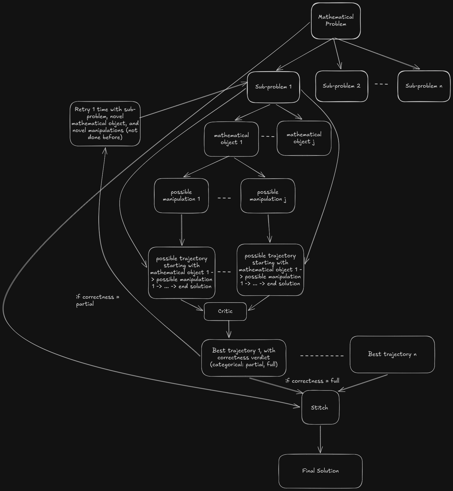
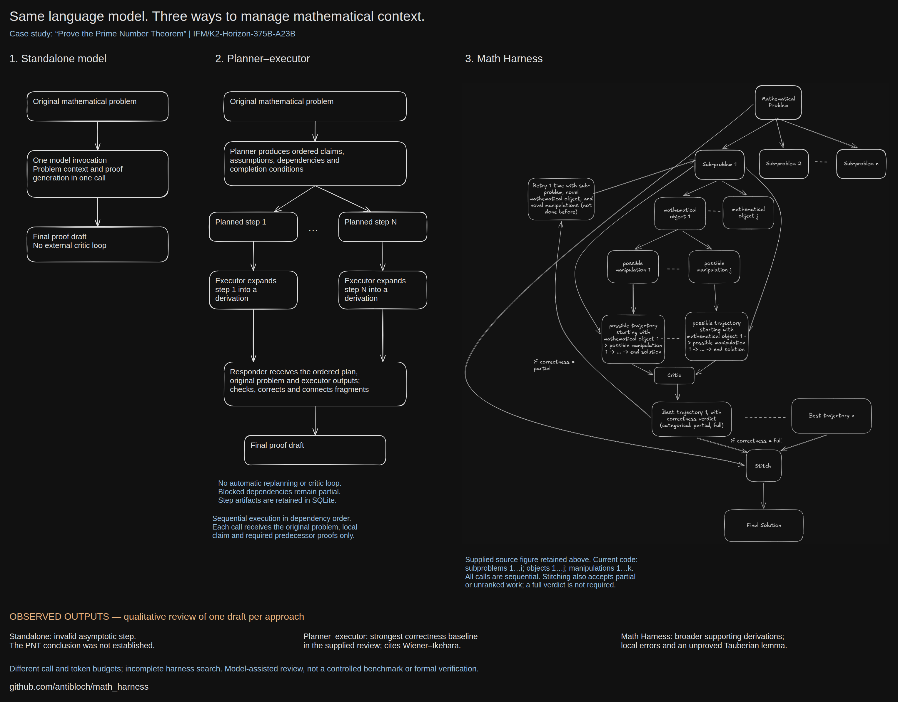

# math_harness

Sequential LangGraph-based mathematical proof search agent.

## Agent Architecture

[](math_agent_architecture.md)

See [math_agent_architecture.md](math_agent_architecture.md) for the execution flow.
The figure shows the logical branches; the implementation executes them sequentially.

## Comparing the Three Architectures

[](docs/architecture-comparison.pdf)

[Zoomable PDF](docs/architecture-comparison.pdf) · [Editable Excalidraw diagram](docs/architecture-comparison.excalidraw)

| Approach | Flow | Context management and feedback |
|----------|------|---------------------------------|
| Standalone LLM | Problem → model → proof draft | One invocation receives the problem and develops the whole argument; no external critic or repair loop. |
| Planner–executor–responder | Problem → ordered plan → sequential step execution → responder | Each executor call receives the original problem, its local claim and required predecessor proofs. The responder receives the plan and executor outputs. No automatic replanning or critic loop. |
| Math Harness | Problem → subproblems → objects → manipulations → trajectories → local critic → stitcher | Each branch owns its candidates and feedback. A partial critic verdict allows one local retry. The stitcher receives all goals and the latest assessed selections, or available unranked work when no selection exists. |

The comparison retains the supplied harness source figure. Its logical branches
do not imply parallel execution: the current implementation runs sequentially and
also stitches partial or unranked work. Diagram outcome annotations describe the earlier proof samples. The planner–executor
sample has since been replaced; see the current comparison below. Those annotations
are historical observations, rather than general performance guarantees.

A runnable [minimal planner–executor port](planner_executer/README.md) is included:

```bash
uv run python -m planner_executer --problem "Prove PNT" --output-dir result/planner_pnt
```

It uses the same IFM adapter and timeout/rate-limit protections. The current
planner–executor sample below comes from this minimal port with a five-step plan,
saved executor work and a recovered final synthesis call.

## Sample Proofs and Quality Comparison

The same underlying model, `IFM/K2-Horizon-375B-A23B`, was prompted with
**“Prove PNT”** (the Prime Number Theorem) through three approaches:

| Approach | Sample draft | Qualitative finding |
|----------|--------------|---------------------|
| Standalone LLM | [Proof](proofs/standalone_llm_proof.md) | Invalid decisive asymptotic inference; the PNT deduction fails. |
| Planner–executor–responder | [Proof](proofs/planner_executor_proof.md) | New five-step draft: develops a contour/zero-sum route, but invokes major analytic results and retains unsupported estimates; its previous correctness ranking no longer applies. |
| Math Harness | [Proof](proofs/math_harness_proof.md) | Broad elementary and Tauberian development, but local errors, corrupted expressions and an unproved Tauberian lemma remain. |

Read the [proof-quality comparison](proofs/COMPARISON.md) for specific findings,
external theorem dependencies, and evaluation limitations. The initial comparison
was performed using **GPT-6 Instant**, as reported by the author, on the earlier
samples. The replacement planner–executor draft has not undergone that same
comparison; its updated assessment records issues found in the new text. These
are unverified drafts from unequal inference budgets, and both multi-stage samples
include incomplete intermediate work. No general superiority is established.

## Requirements

- Python >= 3.11
- [uv](https://docs.astral.sh/uv/)

```bash
uv sync
```

## Configuration

Export your API key in the environment (`.env` is **not** auto-loaded):

```bash
export IFM_API_KEY="your-key-here"
```

The agent uses `langchain_openai.ChatOpenAI` pointed at:

- **Endpoint:** `https://api.ifm.ai/v1`
- **Model:** `IFM/K2-Horizon-375B-A23B`

## Usage

```bash
uv run python -m math_agent "Prove PNT" --i 9 --j 3 --k 3
```

Offline deterministic demo (no API calls, even-integer fixture):

```bash
uv run python -m math_agent --demo
```

## CLI Arguments

| Flag | Alias | Default | Description |
|------|-------|---------|-------------|
| `--subproblems` | `--i` | 2 | Number of subproblems to decompose into |
| `--objects` | `--j` | 2 | Objects generated per subproblem |
| `--manipulations` | `--k` | 2 | Manipulations per object (one trajectory each) |
| `--request-timeout` | | 900 | Total seconds per API attempt (read same; connect 15, write 30, pool 30) |
| `--api-retries` | | 2 | Max additional transient attempts (0 disables) |
| `--max-tokens` | | 32768 | Completion-token limit per API call |
| `--output` | | — | Optional path for JSON output |
| `--demo` | | — | Run offline deterministic fixture |

Initial candidate count is `i * j * k` (absent failures); a retry can add one further local attempt.

## Execution Model

All execution is **strictly sequential**. No concurrency argument is exposed.

1. **Decomposition** – LangGraph splits the goal into subproblems.
2. **Search** – Each subproblem generates `j` objects, then `k` manipulations per object, one trajectory per manipulation. Each object finishes its trajectories before the next object begins. A critic picks the best after all local routes finish.
3. **Retry** – A partial verdict retries the branch once with history requesting new reasoning. API errors are handled separately from mathematical retries; available candidates and earlier critic selections are retained. A branch with an execution error skips its critic and supplies unranked candidates unless an earlier critic selection exists.
4. **Stitching** – All goals are stitched using the latest critic-selected candidate, unranked candidates, or the goal alone.

## Rate Limiting & Error Handling

- Retried on: 408, 429, 499, 5xx, connection errors, timeouts.
- `Retry-After` honored when present; otherwise exponential backoff (30 s base with jitter).
- Waits exceeding 300 seconds or explicit daily-quota exhaustion stop retrying that API call. The pipeline retains available work and proceeds to other routes and final stitching.
- **Not retried:** malformed JSON, invalid model output, truncation, authentication errors and invalid requests.
- Each attempt has a cancellable total deadline; retries do not consume the one mathematical retry. These safeguards bound waiting but cannot guarantee provider availability or valid model output.

## Output

Results are written to `result/run_N/`:

- `proof.md` – drafted proof
- `run.json` – all search results, critic verdicts, and sanitized API failure diagnostics

Existing directories are skipped (no overwrite).

`status: complete` means a draft was produced. `search_status` (`full` / `incomplete`) is tracked separately. The agent does **not** certify correctness.

## Modules

| File | Role |
|------|------|
| `graph.py` | Orchestration (LangGraph) |
| `model.py` | Prompts and API interaction |
| `__main__.py` | CLI and result writing |
| `demo.py` | Offline deterministic fixture |

## Tests

```bash
uv run python -m unittest discover -s tests -v
```
